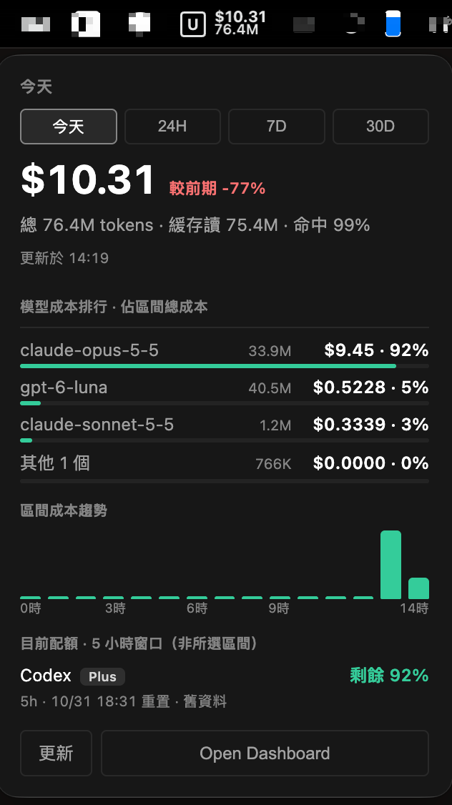
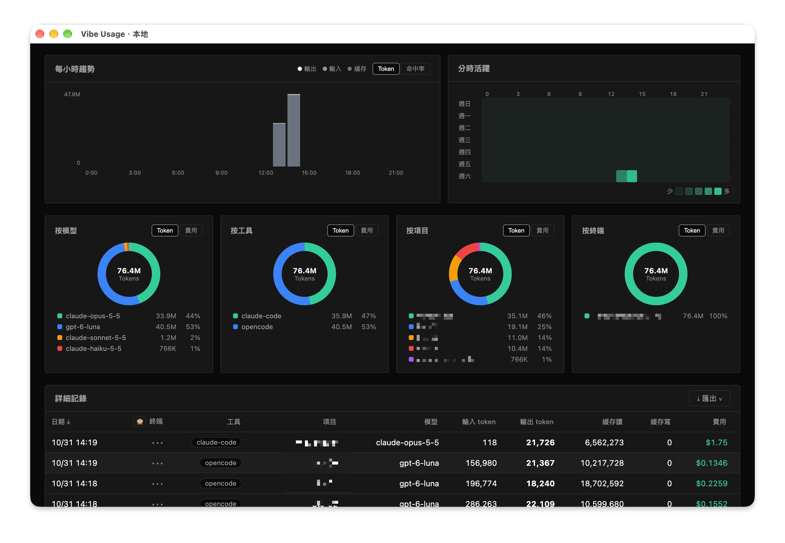

# vibe-usage-desktop

English | [繁體中文](README.zh-TW.md)

Cross-platform desktop shell (macOS / Windows / Linux) for
[vibe-usage-local-server](https://github.com/jwcrystal/vibe-usage-local-server)
— Electron app that embeds the zero-dependency local server and shows its dashboard.

- Tray icon + menu: open dashboard, launch at login, quit; on macOS the menu
  bar shows the dashboard's selected-range cost and token totals as two
  stacked lines (other platforms: same numbers in the tooltip)
- Embedded server on `http://127.0.0.1:3456` (same data file
  `~/.vibe-usage-server/data.json`, same price table)
- Closing the window keeps the app in the tray; quit via tray menu
- If port 3456 is already in use (e.g. the launchd agent), the app just
  connects to the running server — no conflict, shared data
- Version is shown in the dashboard header, the menu-bar popover and About
  (desktop, bundled CLI, Electron); `vibe-usage --version` prints the bundled
  CLI's own version

## Platform notes

- Subscription quotas are fetched on all three platforms; the dashboard is the
  surface that lists them. The popover panel and the menu-bar readout are
  macOS-only — on Windows and Linux the tray shows a menu (including the four
  Quota Sync toggles) and the dashboard cards.
- Only Codex, CommandCode, Claude Code, and OpenCode Go upload quota snapshots
  to the dashboard. Kimi, Z.ai (ZCode), and Grok are read locally by `cli/` and
  are not synced; Cursor is detected but has no quota route.
- Background sync needs a service manager: launchd (macOS), systemd (Linux),
  Task Scheduler (Windows). On a Linux host without systemd, `daemon install`
  reports the platform as unsupported; the dashboard's 更新 button still runs a
  one-shot sync, which also refreshes the quotas you enabled.
- A quota card's login button runs the product's own CLI in a terminal:
  Terminal.app on macOS, a `cmd` window on Windows, and the first available
  terminal emulator on Linux. When none can be opened, the product page opens
  instead.

## Screenshots

### macOS menu bar

<p align="center">
  
</p>

### Expanded dashboard



## Setup

```bash
npm install
npm start
```

`server/` and `cli/` are committed vendored snapshots — the app builds and
runs without any sibling checkout. To refresh them, clone the source repos
next to this one and re-sync:

```bash
git clone https://github.com/jwcrystal/vibe-usage-local-server ../vibe-usage-local-server
git clone https://github.com/jwcrystal/vibe-usage ../vibe-usage   # our fork of vibe-cafe/vibe-usage
npm run sync-server   # vendor ../vibe-usage-local-server/src -> ./server
npm run preflight     # vendor ../vibe-usage @HEAD -> ./cli
```

## Smoke test

```bash
npm run smoke         # starts embedded server, GET /, exits 0/1
npm test              # node:test unit tests (login launcher, path rules)
```

## Build installers

```bash
npm run dist:mac      # dist/ Vibe Usage Desktop.dmg (unsigned)
npm run dist:win      # dist/ NSIS installer
npm run dist:linux    # dist/ AppImage
npm run dist          # all three (cross-build from any host)
```

## Icon

`icon-source.svg` is adapted from
[vibe-usage-app](https://github.com/vibe-cafe/vibe-usage-app)'s pixel-art mark
(recolored white on indigo; upstream MIT). Regenerate:

```bash
magick -background none icon-source.svg -resize 1024x1024 build/icon.png
```

## Acknowledgements

- [`cli/`](cli/) — vendored from our fork [jwcrystal/vibe-usage](https://github.com/jwcrystal/vibe-usage) (MIT, based on [vibe-cafe/vibe-usage](https://github.com/vibe-cafe/vibe-usage)), re-synced via `scripts/sync-cli.sh`
- [`server/`](server/) — vendored from [vibe-usage-local-server](https://github.com/jwcrystal/vibe-usage-local-server)
- App icon adapted from [vibe-usage-app](https://github.com/vibe-cafe/vibe-usage-app) (MIT)

## License

MIT — see [LICENSE](LICENSE). `cli/` contains vendored upstream code (MIT),
see [cli/NOTICE](cli/NOTICE).
